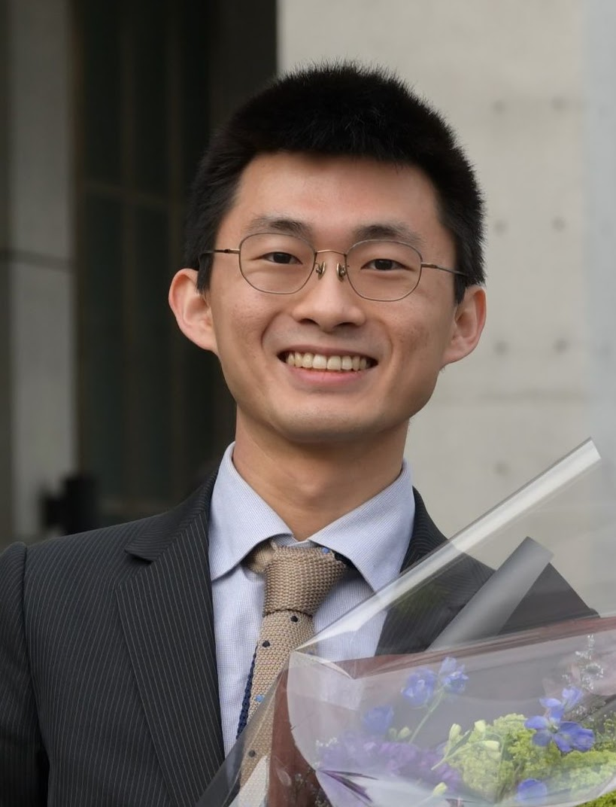

Chuo University & the University of Tokyo

{width=200}

[CV (English)](https://drive.google.com/file/d/1wNvO8kp9BQlGE6sFnVoH8SvuL2nOOHKv/view?usp=sharing)

## Welcome! {#h-uv36kjcsml4p}

I am interested in understanding how dynamics at the collective and societal levels emerge from the accumulation of everyday communication as individuals go through their lives. Outcomes in team sports or patterns of social inequality, for instance, can be viewed as consequences of repeated interactions among many individuals. However, in studies of specific topics, including sports science and the sociology of inequality, technical constraints have often limited the extent to which temporal dynamics are explicitly incorporated.

My aim is to revisit and reorganise the knowledge accumulated in these individual fields from the perspective of temporal change, and thereby contribute to a deeper understanding of social dynamics. Rather than attempting to reproduce empirical reality in full detail, I seek to identify the essential features of collective behaviour arising from human interactions through the use of mathematical models.

Motivated by this perspective, I address research problems in areas such as sports science and social stratification by employing dynamical systems, in particular systems of differential equations, to examine both the possibilities and the limitations of describing how collective behaviour emerges from microscopic interactions. Taking into account recent developments in data-driven approaches, my focus is not on high-precision reproduction or prediction, but on deepening our understanding through mechanistic mathematical models. Specifically, I am interested in clarifying which assumptions and simplifications allow qualitative dynamics to be described and analysed, and conversely, at what point further simplification leads to the breakdown of a model. Through such investigations, I aim to propose theoretical frameworks that complement the empirical knowledge accumulated within each field. More specifically, for each focal phenomenon, I construct and analyse minimal dynamical systems models with a small number of assumptions, with the aim of elucidating the mechanisms by which microscopic interactions give rise to collective behaviour.

## Employment / Fellowship / Teaching {#h-19d1gm6whek2}

2026/04 - Assistant Professor, School of Science and Engineering, Chuo University\
(Dept. of Information and System Engineering, Faculty of Science and Engineering)

2025/06 - Project Researcher, Interfaculty Initiative in Information Studies, the University of Tokyo

2024/09 - 2025/02 Fellowship to external doctoral candidates, SFB1294 Data Assimilation

Biological Physics Group (Prof. Dr. Carsten Beta), Universität Potsdam (Germany)

2024/04 - 2026/03 Research Fellowship for Young Scientists (DC2), Japan Society for the Promotion of Science

2021/10 - 2024/03 Research Assistant for [World-leading Innovative Graduate Study Program in  Proactive Environmental Studies (WINGS-PES)](https://wings-pes.edu.k.u-tokyo.ac.jp/home-english)

2023/04 - 2023/07 Teaching Assistant for "Nonlinear System Analyses II" at the University of Tokyo

2022/04 - 2022/07 Teaching Assistant for "Bio Information Processing" at the University of Tokyo

## Education {#h-hlm2rcb5hgou}

2023/04 - 2026/03

Nonlinear Physics Group, 

Doctoral Course, Department of Complexity Science and Engineering,

Graduate School of Frontier Sciences, The University of Tokyo

Thesis: Noise-induced escape in a population of bistable elements: interplay of nonlinearity, interaction, and noise

2021/04 - 2023/03

Nonlinear Physics Group, 

Master Course, Department of Complexity Science and Engineering,

Graduate School of Frontier Sciences, The University of Tokyo

Thesis: Dynamical systems models for the influence of peers over university enrolment

2020/03 - 2021/03

Nishino Lab, Department of Systems Innovation, 

Faculty of Engineering, The University of Tokyo

## Awards {#h-akphitpy7499}

2025-06 Special monthly stipends (12 months)

- Japan Society for the Promotion of Science

- Award for excellent research achievement during the first year of Research Fellowship for Young Scientists (DC2)

2024-06 Exemption from Repayment for Graduate School Students with Particularly Outstanding Achievements (all)

- Japan Student Services Organization

- Award for outstanding academic achievement during the first year of PhD program

2023-06 Exemption from Repayment for Graduate School Students with Particularly Outstanding Achievements (half)

- Japan Student Services Organization

- Award for outstanding academic achievement during the master course

2023-03-23 Dean's Award for Outstanding Achievement (Master Course)

- Graduate School of Frontier Sciences, the University of Tokyo

- Award for outstanding academic achievement during the master course

2021-03-18 [Hatakeyama award (link: Japanese)](https://www.jsme.or.jp/archive/award/shou4-20.pdf) 

- the Japan Society of Mechanical Engineers

- Award for outstanding academic achievement during undergraduate studies

## Other Activities {#h-slljhubmkf22}

2026/03 Completed ["World-leading Innovative Graduate Study Program in Proactive Environmental Studies” (WINGS-PES)](https://wings-pes.edu.k.u-tokyo.ac.jp/en/), the University of Tokyo

2023/04 - 2024/08 Manager of [UTalk (link: Japanese)](https://fukutake.iii.u-tokyo.ac.jp/utalk/)

- Interfaculty Initiative in Information Studies, the University of Tokyo

- UTalk is a science café that takes place every month, where general participants talk casually with a researcher of UTokyo.

- Manager is responsible for most administrative tasks of UTalk.

2023/04 Two lecturers in "Programming Course"

- Kagaku Gijutsu Gakuen High School (Correspondence Course)

2019/04 - 2023/03 Assistant of [UTalk (link: Japanese)](https://fukutake.iii.u-tokyo.ac.jp/utalk/)

- Interfaculty Initiative in Information Studies, the University of Tokyo

- UTalk is a science café that takes place every month, where general participants talk casually with a researcher of UTokyo.

- Assistant helps organize UTalk at the venue, takes pictures, and writes reports for the website on a shift basis.

2017 - 2019 Paid Volunteer at [DO-IT Japan (link: Japanese)](https://doit-japan.org/)

- Research Center for Advanced Science and Technology, the University of Tokyo

- DO-IT Japan is a project that aims to realize inclusive society through advancing the success of children and youth with disabilities and illnesses.

- I experienced both the assistance in activities of daily living for participants with disabilities and administrative works regarding the project.

2016/04 - 2019/03 [Trilingual Program (TLP) German (link: Japanese)](https://deutsch.c.u-tokyo.ac.jp/v20/tlp/)

- the University of Tokyo

- TLP is a special language course during undergraduate program, where students with a certain level of English proficiency learn a second foreign language (German, in my case) from scratch through additional language classes.

- I participated in the short-term study abroad program of TLP German twice, once in Bonn (Feb. 2017) and once in Köln (Mar. 2019).

- In Köln, I joined a German course for ERASMUS students at Universität zu Köln. 

## Skills {#h-i5boh0heqpmn}

### Languages {#h-cxiu8xsycn11}

- Japanese (Native)

- English (Fluent)

  - 2020/06 TOEFL iBT Score: 104

  - 2020/02 Passed the exam for "National Government Licensed Guide Interpreter" (English)

    - In principle, I can work as a nationally certified travel guide in Japan (if I complete the administrative procedure).

- German (Conversational)

  - 2019/03 Goethe Zertifikat Deutsch B2

### Programming {#h-mrcvqz4mz6a0}

I like coding! I usually work with Docker / Apptainer containers.

- Julia (intermediate)

- Python (advanced)

- R (advanced beginner)

- Java / JavaScript / Google App Script (beginner)

- Mathematica (advanced beginner)

- LaTeX (advanced)

- Typst (beginner)
