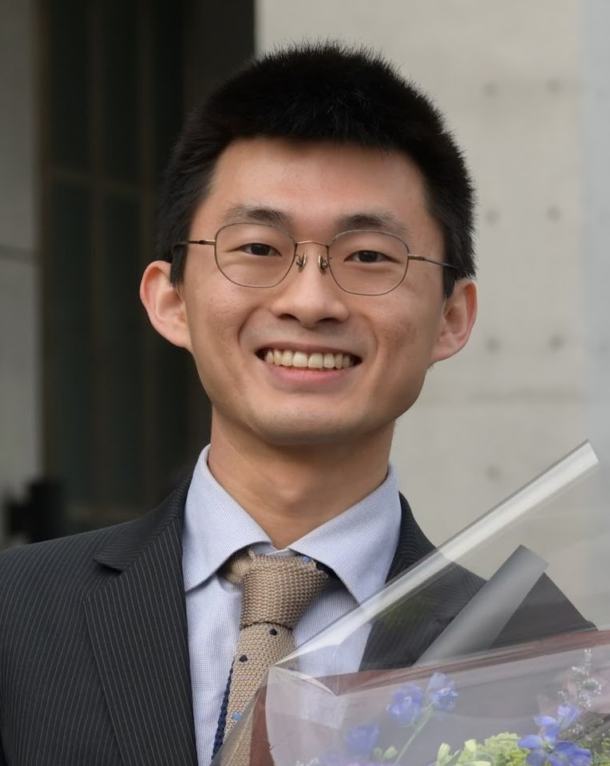

{width=200}

### 石井秀昌（ISHII Hidemasa） {#h-kgam9jctmn5x}

複数の要素が相互作用する複雑な系のダイナミクスを記述する数理モデルの構築・解析に取り組んでいます。数理的には、複雑な現象の理解を深めるためのモデル縮約に惹かれています。また数理モデルを用いて、スポーツ科学・社会学など計量分析の蓄積がある分野に貢献することを目指しています。

## 職歴 {#h-fgi4lc3w9k3z}

2026/04 - 中央大学理工学術院　助教\
配属：先進理工学部情報工学科　[数理最適化研究室](https://sites.google.com/g.chuo-u.ac.jp/opt-lab/)

2025/06 - 東京大学大学院情報学環　特任研究員（カフェイベントUTalkにおける学術コミュニケーション）

2024/09 - 2025/02 Fellowship to external doctoral candidates, SFB1294 Data Assimilation

Biological Physics Group (Prof. Dr. Carsten Beta), Universität Potsdam（ドイツ）

2024/04 - 2026/03 日本学術振興会　特別研究員DC2（機会の不平等に個人間の相互作用が及ぼす影響の数理モデルによる分析）

2021/10 - 2024/03 [プロアクティブ環境学国際卓越大学院プログラム（WINGS-PES）](https://wings-pes.edu.k.u-tokyo.ac.jp/)　卓越リサーチ・アシスタント

2023/04 - 2023/07 東京大学「非線形システム解析論II」ティーチング・アシスタント

2022/04 - 2022/07 東京大学「生体情報論」ティーチング・アシスタント

## 学歴 {#h-8jphn1d9ilmk}

2026-03-24 東京大学大学院新領域創成科学研究科　博士課程　修了　［博士（科学）］

- 複雑理工学専攻　[非線形物理学研究室](https://www.hk.k.u-tokyo.ac.jp/)　（指導教員：郡宏教授）

- 博士論文 "Noise-induced escape in a population of bistable elements: interplay of nonlinearity, interaction, and noise"\
  （双安定系の集団におけるノイズ誘起脱出の分析：非線形性，相互作用とノイズの相乗効果）

2023-03-23 東京大学大学院新領域創成科学研究科　修士課程　修了　［修士（科学）］

- 複雑理工学専攻　[非線形物理学研究室](https://www.hk.k.u-tokyo.ac.jp/)　（指導教員：郡宏教授）

- 修士論文 "Dynamical systems models for the influence of peers over university enrolment"\
  （大学進学に周囲の生徒が与える影響の数理モデルによる分析）

2021-03-18 東京大学工学部システム創成学科　卒業

- 知能社会システム（PSI） コース　[西野研究室](https://www.css.t.u-tokyo.ac.jp/home)

- 卒業論文「進化ゲーム理論を用いた安定結婚問題のゲームダイナミクスの分析」

2016-03-01 東京学芸大学附属高等学校　卒業

## 受賞 {#h-ry8gi68fo8kx}

2025-06 日本学術振興会　研究奨励金特別手当（12ヶ月）

2024-06 日本学生支援機構　特に優れた業績による返還免除（全額）

2023-06 日本学生支援機構　特に優れた業績による返還免除（半額）

2023-03-23 新領域創成科学研究科長賞（修士）

2021-03-18 [日本機械学会畠山賞](https://www.jsme.or.jp/archive/award/shou4-20.pdf)

2019-09-17 東京大学数理・データサイエンスコンソーシアム　データサイエンスコンテスト　優秀賞（チーム: psi_overfit）

## その他の活動 {#h-9hepj19shvse}

2026/07 共同通信社配信の子ども向け連載【わたしの仕事】で取り上げてもらいました\
・[毎日新聞地方版](https://mainichi.jp/articles/20260710/ddl/k13/040/009000c)をはじめ、主に地方紙に掲載されるようです

2026/04 - 神奈川県大和市でカフェイベント「あっちこっちトーク」を共同主催

2026/03 [プロアクティブ環境学国際卓越大学院プログラム（WINGS-PES）](https://wings-pes.edu.k.u-tokyo.ac.jp/)　修了

2024/01 - 2026/02 プロアクティブ環境学国際卓越大学院プログラム（WINGS-PES）　モデリング勉強会　主催

2023/04 - 2024/08 東京大学大学院情報学環・福武ホール主催のカフェイベント[UTalk](https://fukutake.iii.u-tokyo.ac.jp/utalk/)　マネージャー

2023/04 科学技術学園高等学校　通信制課程「プログラミング講座」（2回担当）

2019/04 - 2023/03 東京大学大学院情報学環・福武ホール主催のカフェイベント[UTalk](https://fukutake.iii.u-tokyo.ac.jp/utalk/)　アシスタント

2017 - 2019 [DO-IT Japan](https://doit-japan.org/)　有償ボランティア（東京大学先端科学技術研究センター）\
・障害のある生徒・学生を対象とした進学・就労支援プログラム\
・介助と、プログラムの運営に関する事務作業の両方を経験させていただきました

2019/03 東京大学[トライリンガルプログラム・ドイツ語](https://deutsch.c.u-tokyo.ac.jp/v20/tlp/)　修了

## Skills {#h-bbd4yr7zy8wr}

### 言語 {#h-b1j6e4uj0mm5}

- 日本語 (native)

- 英語 (fluent)

  - 2020/06 TOEFL iBT Score: 104

  - 2020/02 「全国通訳案内士（英語）」試験合格

    - 国家資格を持つ全国通訳案内士（観光ガイド）として働くための資格です。事務手続き・手数料の支払いをしていないので、免許は持っていません。

- ドイツ語 (conversational)

  - 2019/03 Goethe Zertifikat Deutsch B2

### プログラミング {#h-s79fmrvust9h}

コーディングが好きです。基本的に Docker / Apptainer コンテナを使って作業しています。日本語はかな入力です。

- Julia (intermediate)

- Python (advanced)

- C / C++ (advanced beginner)

- R (advanced beginner)

- Java / JavaScript / Google App Script (beginner)

- Mathematica (advanced beginner)

- LaTeX (advanced)

- Typst (beginner)
