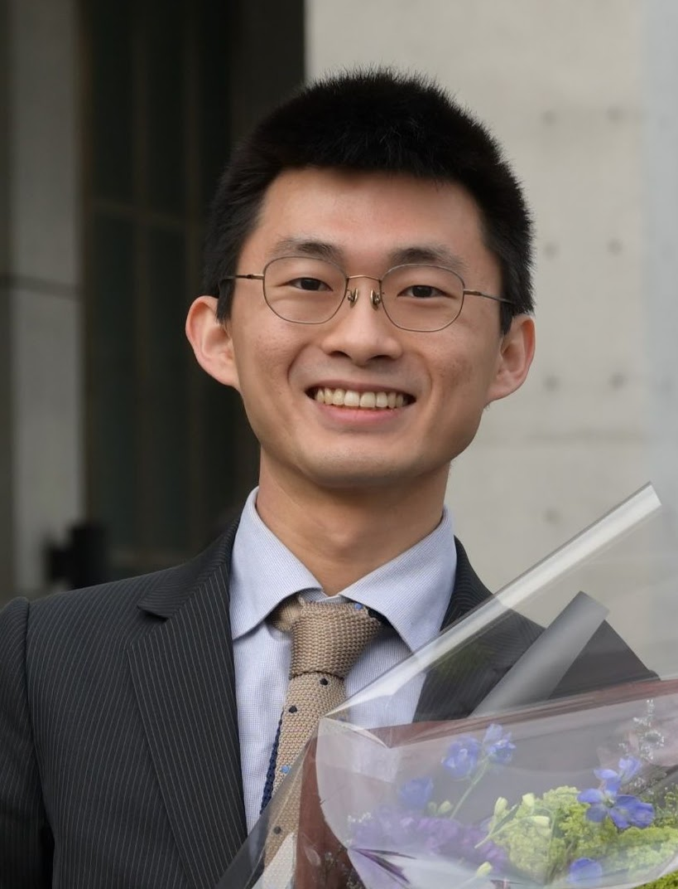

---
aliases:
  - /about/en.html
title: "ISHII Hidemasa"
---

Assistant Professor, School of Science and Engineering, Chuo University

Project Researcher, Interfaculty Initiative in Information Studies, the University of Tokyo

{width=200}

## Welcome! {#h-uv36kjcsml4p}

I am interested in understanding how dynamics at the collective and societal levels emerge from the accumulation of everyday communication as individuals go through their lives. Outcomes in team sports or patterns of social inequality, for instance, can be viewed as consequences of repeated interactions among many individuals. However, in studies of specific topics, including sports science and the sociology of inequality, technical constraints have often limited the extent to which temporal dynamics are explicitly incorporated.

My aim is to revisit and reorganise the knowledge accumulated in these individual fields from the perspective of temporal change, and thereby contribute to a deeper understanding of social dynamics. Rather than attempting to reproduce empirical reality in full detail, I seek to identify the essential features of collective behaviour arising from human interactions through the use of mathematical models.

Motivated by this perspective, I address research problems in areas such as sports science and social stratification by employing dynamical systems, in particular systems of differential equations, to examine both the possibilities and the limitations of describing how collective behaviour emerges from microscopic interactions. Taking into account recent developments in data-driven approaches, my focus is not on high-precision reproduction or prediction, but on deepening our understanding through mechanistic mathematical models. Specifically, I am interested in clarifying which assumptions and simplifications allow qualitative dynamics to be described and analysed, and conversely, at what point further simplification leads to the breakdown of a model. Through such investigations, I aim to propose theoretical frameworks that complement the empirical knowledge accumulated within each field. More specifically, for each focal phenomenon, I construct and analyse minimal dynamical systems models with a small number of assumptions, with the aim of elucidating the mechanisms by which microscopic interactions give rise to collective behaviour.

## What's New {#whats-new}

- 2026-07-10 Featured in "My Job", a Kyodo News series for children ([the Mainichi Shimbun, regional edition](https://mainichi.jp/articles/20260710/ddl/k13/040/009000c), in Japanese)

- 2026-07-10 Guest at [Camos Tap Talk](https://camos-tap-talks.github.io/ja/talks/4-ishii) (in Japanese)

- 2026-02-27 Preprint on arXiv: [Degree heterogeneity shapes escape mechanisms in networks of diffusively coupled bistable elements](https://arxiv.org/abs/2602.24039)

## Contact {#contact}

E-mail: hishii361 (at) g.chuo-u.ac.jp
