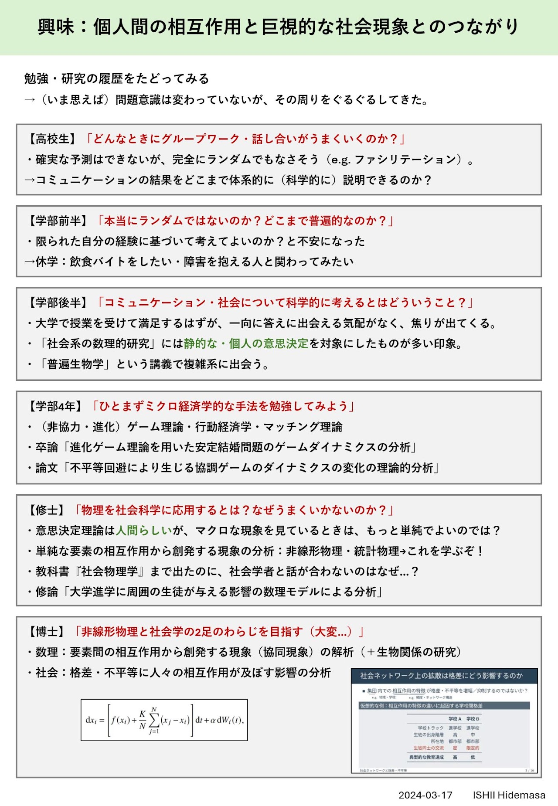

中央大学理工学術院　助教\
東京大学大学院情報学環　特任研究員

[**English page**](/about/en.qmd){.btn .btn-outline-primary}

## こんにちは！ {#h-nck8k4lzdvf2}

私は、人々がそれぞれの人生を送りながらコミュニケーションを積み重ねていく中で、集団・社会のレベルでの動きや変化が生み出される様子を理解したいと思っています。たとえばチームスポーツの勝敗や社会的な格差は、多くの人のコミュニケーションの積み重ねの結果として現れる、と考えることもできます。しかしスポーツ科学や格差の社会学といった個別のテーマに関する研究では、技術的な制約もあり、時間的な変化を十分に扱うことが難しい場合もあります。

私の目標は、こうした個別の分野で蓄積されてきた知見を「時間変化」という視点で整理し直し、新たな理解につなげることです。そのために、現実の細部をそのまま再現するのではなく、数理モデルを用いて、人々の相互作用から生じる集団としての振舞いの本質を見極めることを目指しています。

このような問題意識のもとで、私はスポーツ科学や社会階層論といった分野の研究課題に対して、力学系（特に微分方程式系）を用いてミクロな相互作用から集団的な振舞いが生じる過程を記述することの可能性と限界を検討しています。データ駆動的手法の発展も踏まえて、現象の高精度な再現・予測を目的とはせず、機構的な数理モデルによる現象の理解を重視しています。特に、どのような仮定や単純化を行えば時間発展を含む定性的な振舞いを記述・解析できるのか、そして反対にどこまで単純化するとモデルが破綻するのか、などを検討する際に数理モデルが役立つと考えています。こうした検討を通じて、それぞれの分野が蓄積してきた実証的知見を補完するような理論的枠組みの提示を目指しています。具体的には、個別の現象を対象に、最小限の仮定からなる力学系モデルの構築やその数理的性質の解析を通して、相互作用から集団的振舞いが生じるメカニズムの解明に取り組んでいます。

## What's New {#h-8kg5n8fl9bwq}

- 2026-07-10 共同通信社配信の連載【わたしの仕事】の取材を受けました（[毎日新聞地方版のリンク](https://mainichi.jp/articles/20260710/ddl/k13/040/009000c)）

- 2026-07-10 [かもすタップトーク](https://camos-tap-talks.github.io/ja/talks/4-ishii)にゲストとして参加しました

- 2026-02-27 Preprint on arXiv: [Degree heterogeneity shapes escape mechanisms in networks of diffusively coupled bistable elements](https://arxiv.org/abs/2602.24039)

## Contact {#h-hts3mhxjfh8w}

E-mail: hishii361（at）g.chuo-u.ac.jp

